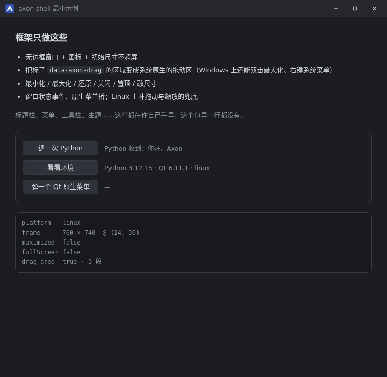

<p align="center">
  
</p>

# axon-shell

给 [Axon](https://github.com/AxonGUI/Axon) 应用补上**网页做不了的那一层**：无边框窗口、可拖动的区域、窗口按钮的原生行为、窗口状态事件、原生菜单桥。

这个包**不含任何界面**——没有标题栏、没有菜单条、没有按钮样式、没有主题、没有一行 CSS。标题栏长什么样、菜单怎么排、按钮用什么图标，全是你自己在页面里写的；它只负责让这些东西真的能拖动、能最小化、能关掉。

<sub>简体中文 · [English](README.en.md)</sub>

---

## 为什么需要它

浏览器里做不出下面三件事，这三件也只有它们需要 Python：

1. **无边框窗口**：去掉系统标题栏（`FramelessWindowHint`），整块界面归你；
2. **拖动与缩放仍然有效**：Windows 上必须接管 `WM_NCHITTEST` 返回 `HTCAPTION`，系统才会给你真实的拖动、双击最大化、拖到边缘贴靠、四边缩放；Linux/macOS 上则退化成 `startSystemMove()` 与指针增量；
3. **控制窗口**：最小化 / 最大化 / 还原 / 关闭 / 置顶 / 改尺寸，以及「窗口状态变了」的事件。

其余全部是前端的事。所以这个包很小，也故意很小：你随时可以不用它，自己写 `Axon.Window` 的调用。

<p align="center"></p>

## 安装

`axon-gui` 与 `axon-shell` 都还没上 PyPI（上架后是两条 `pip install`）。现在：

```bash
# 1) 框架本体：Release 里的 wheel（自带 PySide6）
pip install "https://github.com/AxonGUI/Axon/releases/download/v5.3.4/axon_gui-5.3.4-py3-none-any.whl"

# 2) 外观层。--no-deps：PyPI 上还没有 axon-gui，让 pip 自己解析会 404
pip install --no-deps "git+https://github.com/AxonGUI/AxonShell.git"
```

装完 `python -c "import axon, axon_shell"` 不报错就对了。

## 三十秒接上

**Python 侧**——只换窗口类：

```python
import sys
from PySide6.QtWidgets import QApplication
from axon import AxonController, AxonMagicGUI
from axon_shell import AxonShellWindow

WEB = "MainView"

@AxonController(WEB, id="App")
class App:
    def hello(self, name: str) -> str:
        return f"你好，{name}"

def main() -> int:
    app = QApplication(sys.argv[:1])
    AxonMagicGUI()                     # AxonShellWindow 内部要用
    window = AxonShellWindow(WEB, "http://127.0.0.1:8000/", title="我的应用")
    window.show()
    return app.exec()

raise SystemExit(main())
```

**页面侧**——写自己的标题栏，标两个属性就活了：

```html
<script src="/axon.umd.cjs"></script>          <!-- axon-gui 的 UMD 产物 -->
<script src="/axon-shell/shell.js"></script>   <!-- 这个包唯一的 JS 文件 -->

<header data-axon-drag>                        <!-- 这块区域可以拖动窗口 -->
  <span>我的应用</span>
  <button data-axon-window="min">–</button>    <!-- 三个按钮的行为自动接上 -->
  <button data-axon-window="max">□</button>
  <button data-axon-window="close">×</button>
</header>

<script>
  (async () => {
    await window.axon.AxonInit();
    window.AxonShell.init();                   // 接上拖拽区、按钮、状态事件
    window.AxonShell.window.onState(s => console.log(s.frame));
  })();
</script>
```

`shell.js` 从包里取，静态服务挂到 `/axon-shell/` 即可：

```python
from axon_shell import assets_dir
print(assets_dir())   # .../axon_shell/assets
```

> `data-axon-drag` 里面的按钮、输入框、链接会自动被排除在拖动区之外；
> 不想被自动排除的，加 `data-axon-no-drag` 也可以反过来用。

## 它提供什么

### Python

| 名字 | 说明 |
| --- | --- |
| `AxonShellWindow(web_name, url, title=…, size=…, min_size=…, options=…)` | 继承 `AxonGUI`，去系统边框、设图标、初始尺寸不超出屏幕，注册 `Axon.Window` |
| `Axon.Window`（控制器） | `minimize` `maximize` `restore` `toggleMaximize` `toggleFullScreen` `close` `setAlwaysOnTop` `setTitle` `setDragRegions` `beginSystemMove` `moveTo` `resizeTo` `moveBy` `frame` `state` `platform` `popupMenu` `closeMenu` |
| 事件 `window:state` | 最大化 / 全屏 / 位置尺寸变化（60ms 合并后推一次） |
| 事件 `window:menu` | 原生菜单被选中：`{requestId, id}` |
| `assets_dir()` | `assets` 目录，里面只有 `shell.js`、图标 |

`Axon.Window` 是从 `axon-gui` 的通道调进去的，所以页面里也能直接写
`await Axon.Window.resizeTo(1200, 800)`，不必经过这个 JS 文件。

### 前端（`window.AxonShell`）

| 名字 | 说明 |
| --- | --- |
| `init(opts?)` | 幂等安装：`data-axon-window` 点击、`[data-axon-drag]` 上报、状态/菜单事件订阅 |
| `drag.refresh()` / `drag.regions()` | 重新计算拖动区（布局变了要调）；返回 `[{left,top,width,height}, …]` |
| `window.state()` | `{platform, frame:{x,y,width,height}, maximized, fullScreen}` |
| `window.minimize()` `toggleMaximize()` `close()` `setTitle()` `setAlwaysOnTop()` `refresh()` | 常用窗口操作 |
| `window.onState(cb)` | 订阅窗口状态 |
| `menu.native(spec)` / `menu.onSelect(cb)` | 让 Qt 弹原生菜单；`spec` 是 `{id?, title?, items:[…]}`，每项 `{id,label,shortcut?,kind?:separator/check/radio,checked?,disabled?,items?}` |
| `enableFallback()` | 非 win32/darwin 上补拖动与 8 向缩放（`init()` 会自动开） |

`init()` 之后 `<html>` 上会有 `data-axon-platform="win32|linux|darwin"` 与
`data-axon-maximized="true|false"`，你在 CSS 里可以据此调布局（比如去掉圆角）。

## 各平台怎么动窗口

- **Windows**：Python 接管 `WM_NCHITTEST`——上报的拖动区返回 `HTCAPTION`，边框 6px 返回 `HTLEFT/HTRIGHT/HTTOP/...`。拖动、双击最大化、贴边、四边缩放全是系统行为，没有 JS 手搓的延迟。
- **Linux / macOS**：`startSystemMove()`（X11/macOS 支持）；不支持时 `shell.js` 用指针增量 + `moveTo/resizeTo` 兜底，8 向缩放靠 8 条透明热区。

所以拖动区只要「标出来」就行，不用写 `-webkit-app-region`（Qt 也不认这个）。

## 示例

`examples/basic/` 是一个最小应用：一条可拖动的顶栏、三个窗口按钮、三行演示按钮。

```bash
cd examples/basic
python main.py                 # 需要先 npm install axon-gui（或设 AXON_BUNDLE 指到 axon.umd.cjs）
python main.py --smoke         # 无头自检
python ../../tests/verify.py   # 端到端：拖拽区、按钮、状态、缩放、Python 往返、原生菜单
```

想看「照着这个自己写一整套 VSCode 外观」的完整例子，看
[Axon 文档里的窗口外观页](https://axongui.github.io/Axon/guide/window-chrome)。

## 验证

```bash
python examples/basic/main.py --smoke     # 连通 + 拖拽区 + 窗口
python tests/verify.py                    # 11 条断言，退出码 = 失败数
```

## 版本

`0.2.0` —— 从「带皮肤」收缩成「只做原生那层」。之前的 0.1.x 包含标题栏/菜单/主题，
现在都删了：那些东西你写得比我好。

MIT © STofone
